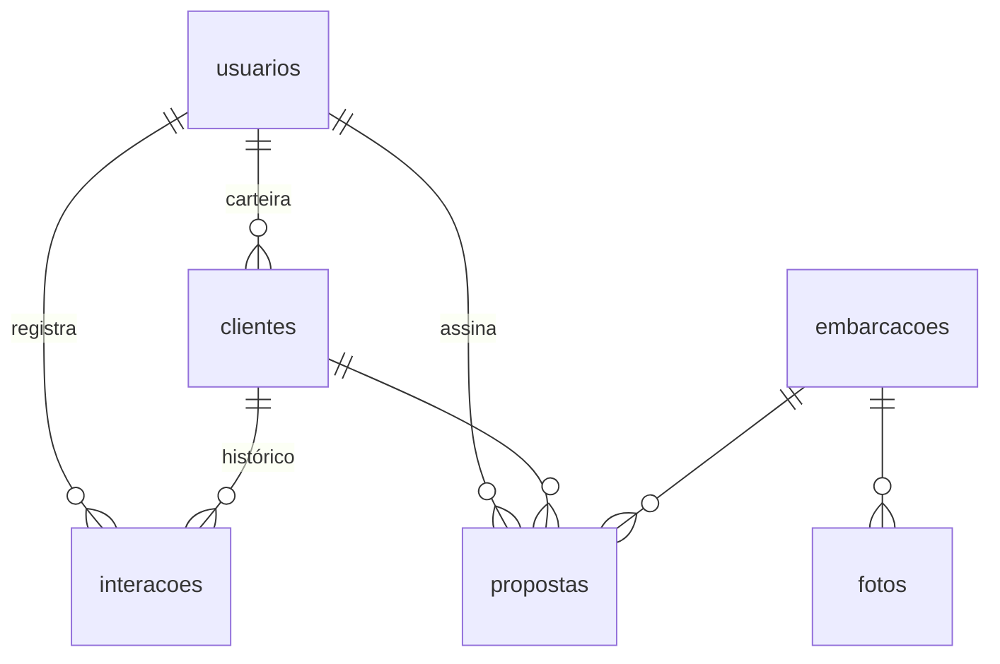

# CRM Regatta Yachts

Sistema interno para os consultores da Regatta Yachts: carteira de clientes, funil de atendimento, estoque de barcos novos e seminovos, propostas de venda no visual da marca e gestão da equipe.

Visual baseado no design system **Regatta Yachts** (Brand Book V04): Tungsten Compressed + Work Sans, azul profundo, petróleo, gelo, filete turquesa e dourado só no botão principal e no valor final.

## O que o sistema faz

| Área | Quem usa | O que faz |
|---|---|---|
| Login | todos | E-mail e senha. Senha provisória obriga a troca no 1º acesso. |
| Painel | todos | Clientes em atendimento, contatos atrasados, propostas em aberto, vendas do mês, agenda dos próximos 7 dias. |
| Funil | todos | Kanban com 8 etapas. Arraste o cartão (ou use "Mover para") para mudar a etapa. |
| Clientes | todos | Cadastro completo, perfil de compra, histórico de contatos (ligação, WhatsApp, sea trial...), próximo contato. |
| Embarcações | todos | Catálogo de novos e estoque de seminovos, ficha técnica, equipamentos e fotos. |
| Propostas | todos | Cálculo automático (opcionais, desconto, troca, entrada, parcelas) e documento pronto para PDF. |
| Equipe | administrador | Cria acessos, gera senha provisória, desativa, transfere carteira. |

**Regras de acesso:** o consultor vê apenas os próprios clientes e propostas. O administrador vê tudo, escolhe o consultor de cada cliente e gerencia a equipe.

**Automações:**
- Registrar um contato com um lead novo leva o cliente para "Primeiro contato".
- Gerar proposta leva o cliente para "Proposta".
- Proposta marcada como "Aceita" leva o cliente para "Venda fechada" e reserva o barco.
- Toda mudança de etapa fica no histórico do cliente, com autor e data.

## Banco de dados (PostgreSQL)



- `usuarios`: nome, e-mail, celular, senha (bcrypt), papel ADMIN/VENDEDOR, ativo, trocarSenha
- `clientes`: contato, CPF/CNPJ, cidade/UF, origem, interesse (novo/seminovo), modelo, orçamento, barco atual, etapa, próximo contato, consultor
- `interacoes`: tipo (ligação, WhatsApp, e-mail, reunião, visita, sea trial, anotação, mudança de etapa, proposta), descrição, data
- `embarcacoes`: condição, marca, modelo, ano, pés, motorização, horas de motor, cabines, capacidade, localização, preço, situação, equipamentos
- `fotos`: imagens das embarcações guardadas no próprio banco
- `propostas`: número RY-AAAA-0000, valores, opcionais, desconto, troca, entrada, parcelas, prazo, validade, situação

Esquema completo: `prisma/schema.prisma`.

## Rodar localmente

Requisitos: Node 20+ e PostgreSQL 14+.

```bash
npm install
cp .env.example .env      # preencha DATABASE_URL e AUTH_SECRET
npx prisma migrate deploy
npm run db:seed           # opcional: dados de exemplo (senha regatta2026)
npm run dev               # http://localhost:3000
```

## Colocar no ar

Recomendado: **Vercel** (site) + **Supabase** ou **Neon** (PostgreSQL).

1. Crie o banco no Supabase/Neon e copie a connection string.
2. Importe este repositório na Vercel e defina `DATABASE_URL` e `AUTH_SECRET` (gere com `openssl rand -hex 32`).
3. Aplique o banco: `DATABASE_URL=... npx prisma migrate deploy`
4. Crie o primeiro administrador:
   ```bash
   DATABASE_URL=... npm run admin:create -- "Seu Nome" voce@regattayachts.com.br
   ```
   O comando mostra uma senha provisória.
5. (Opcional) Aponte um subdomínio, ex.: `crm.regattayachts.com.br`.

**Não rode o seed em produção.**

## Cadastrar um vendedor novo

1. Entre como administrador → **Equipe**.
2. Preencha nome, e-mail e celular (o celular sai na proposta) → **Criar acesso**.
3. O sistema mostra uma senha provisória e um botão que copia a mensagem pronta para enviar por WhatsApp.
4. No primeiro login o vendedor define a senha pessoal.

Esqueceu a senha: **Nova senha provisória**. Saiu da empresa: **Transferir carteira** para outro consultor e **Desativar acesso** (o histórico fica preservado).

## Proposta em PDF

Na proposta, **Baixar PDF / imprimir** abre a impressão do navegador já no formato A4 da marca (capa com a foto do barco, ficha técnica, equipamentos, investimento, condições e contato do consultor). Escolha "Salvar como PDF".

## Estrutura

```
prisma/schema.prisma       tabelas
prisma/seed.ts             dados de exemplo
scripts/criar-admin.ts     primeiro administrador
src/lib/auth.ts            sessão, permissões, senhas
src/app/(app)/             telas internas (painel, funil, clientes, embarcações, propostas, equipe)
src/components/DocumentoProposta.tsx   layout da proposta
src/app/globals.css        tokens do design system Regatta Yachts
public/brand, public/fonts logos e fontes da marca (Tungsten Compressed é licenciada, uso interno)
```
