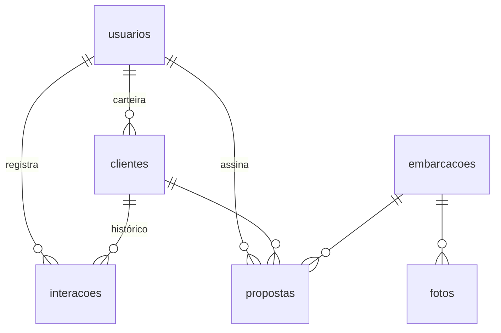

# CRM Regatta Yachts

Sistema interno para os consultores da Regatta Yachts: carteira de clientes, funil de atendimento, estoque de barcos novos e seminovos, propostas de venda no visual da marca e gestão da equipe.

Visual baseado no design system **Regatta Yachts** (Brand Book V04): Tungsten Compressed + Work Sans, azul profundo, petróleo, gelo, filete turquesa e dourado só no botão principal e no valor final.

## O que o sistema faz

| Área | Quem usa | O que faz |
|---|---|---|
| Login | todos | E-mail e senha. Senha provisória obriga a troca no 1º acesso. |
| Painel | todos | Clientes em atendimento, contatos atrasados, propostas em aberto, vendas do mês, agenda dos próximos 7 dias. |
| Funil | todos | Kanban com 8 etapas. Arraste o cartão (ou use "Mover para") para mudar a etapa. |
| Clientes | todos | Cadastro completo, perfil de compra, histórico de contatos (ligação, WhatsApp, sea trial...), próximo contato. |
| Embarcações | todos | Catálogo de novos e estoque de seminovos, ficha técnica, até 30 itens e equipamentos, 1 foto principal (costado) e 3 de detalhe. |
| Propostas | todos | Cálculo automático (opcionais, desconto, troca, entrada, parcelas) e documento pronto para PDF. |
| Equipe | administrador | Cria acessos, gera senha provisória, desativa, transfere carteira. |
| Importar planilha | administrador | Carga em lote de clientes e embarcações por Excel (.xlsx) ou CSV, com conferência antes de gravar. |

**Regras de acesso:** o consultor vê apenas os próprios clientes e propostas. O administrador vê tudo, escolhe o consultor de cada cliente e gerencia a equipe.

**Automações:**
- Registrar um contato com um lead novo leva o cliente para "Primeiro contato".
- Gerar proposta leva o cliente para "Proposta".
- Proposta marcada como "Aceita" leva o cliente para "Venda fechada" e reserva o barco.
- Toda mudança de etapa fica no histórico do cliente, com autor e data.

## Banco de dados (PostgreSQL)



- `usuarios`: nome, e-mail, celular, senha (bcrypt), papel ADMIN/VENDEDOR, ativo, trocarSenha
- `clientes`: contato, CPF/CNPJ, cidade/UF, origem, interesse (novo/seminovo), modelo, orçamento, barco atual, etapa, próximo contato, consultor
- `interacoes`: tipo (ligação, WhatsApp, e-mail, reunião, visita, sea trial, anotação, mudança de etapa, proposta), descrição, data
- `embarcacoes`: condição, marca, modelo, ano, pés, motorização, horas de motor, cabines, capacidade, localização, preço, situação, equipamentos
- `fotos`: imagens das embarcações guardadas no próprio banco
- `propostas`: número RY-AAAA-0000, valores, opcionais, desconto, troca, entrada, parcelas, prazo, validade, situação

Esquema completo: `prisma/schema.prisma`.

## Rodar localmente

Requisitos: Node 20+ e PostgreSQL 14+.

```bash
npm install
cp .env.example .env      # preencha DATABASE_URL e AUTH_SECRET
npx prisma migrate deploy
npm run db:seed           # opcional: dados de exemplo (senha regatta2026)
npm run dev               # http://localhost:3000
```

## Colocar no ar (só pelo navegador)

Recomendado: **Supabase** ou **Neon** (banco PostgreSQL, plano gratuito) + **Vercel** (site, plano gratuito). O `vercel.json` roda o site em São Paulo (`gru1`), perto do banco.

1. **Banco:** em neon.tech, crie uma conta e um projeto (região São Paulo, se houver). Copie a *connection string* (`postgresql://...`).
2. **Site:** em vercel.com, entre com o GitHub → **Add New → Project** → importe `site-crm-yachts`.
3. Antes de clicar em Deploy, abra **Environment Variables** e crie:
   - `DATABASE_URL` = a connection string do Neon (no Supabase: *Transaction pooler*, porta 6543, com `?pgbouncer=true&connection_limit=1&schema=crm`)
   - `DIRECT_URL` = a mesma do Neon (no Supabase: *Session pooler*, porta 5432, com `?schema=crm`)
   - `AUTH_SECRET` = um texto aleatório com 32 caracteres ou mais
4. **Deploy.** A publicação cria as tabelas no banco sozinha.
5. Abra o endereço que a Vercel mostrar. Como o banco está vazio, o site abre em **Criar administrador**: cadastre-se logo em seguida. Essa tela some depois do primeiro cadastro.
6. Em **Equipe**, cadastre os vendedores.
7. (Opcional) Em Vercel → Settings → Domains, aponte um subdomínio, ex.: `crm.regattayachts.com.br`.

Alternativa pelo terminal para criar ou recuperar um administrador:
```bash
DATABASE_URL=... npm run admin:create -- "Seu Nome" voce@regattayachts.com.br
```

**Não rode o seed (dados de exemplo) em produção.**

## Cadastrar um vendedor novo

1. Entre como administrador → **Equipe**.
2. Preencha nome, e-mail e celular (o celular sai na proposta) → **Criar acesso**.
3. O sistema mostra uma senha provisória e um botão que copia a mensagem pronta para enviar por WhatsApp.
4. No primeiro login o vendedor define a senha pessoal.

Esqueceu a senha: **Nova senha provisória**. Saiu da empresa: **Transferir carteira** para outro consultor e **Desativar acesso** (o histórico fica preservado).

## Importar clientes e embarcações em lote

Menu **Importar planilha** (só administrador):

1. **Baixe o modelo** (.xlsx) de clientes ou de embarcações. Ele traz as colunas certas, menus nos campos de lista e uma aba **Instruções** com exemplos. Colunas com `*` são obrigatórias.
2. **Envie para conferir.** Nada é gravado: o sistema mostra cada linha como *Pronta*, *Já existe* ou *Erro*, com o motivo.
3. **Importe.** Só as linhas prontas entram. Linhas com erro podem ser corrigidas e enviadas depois.

- Aceita `.xlsx` e `.csv` (vírgula ou ponto e vírgula, inclusive o CSV salvo pelo Excel em português). Até 2.000 linhas e 5 MB por arquivo.
- Não duplica: clientes com o mesmo CPF/CNPJ, e-mail ou celular; seminovos com a mesma inscrição; novos com o mesmo modelo e ano. Vale contra o banco e dentro do próprio arquivo, então reimportar o mesmo arquivo é seguro.
- Clientes: a coluna *E-mail do consultor* define o responsável (vazio = quem importou). Cada cliente ganha no histórico "Cliente importado da planilha".
- Embarcações: fotos não vão na planilha. Depois de importar, envie o costado e os detalhes na página de cada barco.

## Proposta em PDF

A proposta é **uma única folha A4** (210 × 297 mm), na ordem de leitura:

1. Topo com logo, número e data
2. Foto principal do costado em **4:3 horizontal**, ao lado do nome do modelo, do cliente, do consultor e da validade
3. Três fotos de detalhe, cada uma em **4:3 horizontal ou 3:4 vertical** conforme a própria foto
5. Ficha técnica e condições | investimento e **valor final** (em dourado)
6. Itens e equipamentos (até 30, em 3 colunas)
7. Rodapé com o contato do consultor

Se o conteúdo for longo (muitos itens ou opcionais), o texto do corpo diminui sozinho, até 72%, para caber na folha. Se mesmo assim não couber, um aviso aparece acima da proposta. Também aparece um aviso quando faltam fotos da embarcação ou quando alguma foge do 4:3 / 3:4 (nesse caso ela é recortada para caber).

Para baixar, use **Baixar PDF / imprimir** e escolha "Salvar como PDF".

## Estrutura

```
prisma/schema.prisma       tabelas
prisma/seed.ts             dados de exemplo
scripts/criar-admin.mts     primeiro administrador
src/lib/auth.ts            sessão, permissões, senhas
src/app/(app)/             telas internas (painel, funil, clientes, embarcações, propostas, equipe)
src/components/DocumentoProposta.tsx   layout da proposta
src/app/globals.css        tokens do design system Regatta Yachts
public/brand, public/fonts logos e fontes da marca (Tungsten Compressed é licenciada, uso interno)
```
